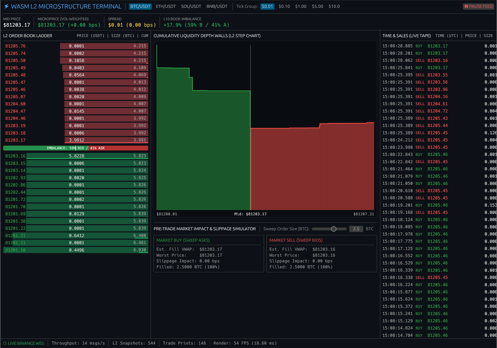

# wasm-trading-orderbook



A client-side Level 2 Limit Order Book visualizer built with Rust, WebAssembly, and `egui`. It streams live market depth directly from Binance via WebSockets.

## Features

* **L2 Depth Ladder & Tick Aggregation:** Real-time bid/ask depth bars, cumulative volume shading, and dynamic tick-size bucketing (`$0.01` to `$10.00`).
* **Quantitative Microstructure Signals:** Volume-weighted Microprice, Micro-Delta (bps), Spread (bps), and Top-10 Order Book Imbalance (OBI).
* **Cumulative Depth Chart & Slippage Simulator:** WebGL stepped liquidity wall visualization with hover inspection and an interactive VWAP market-impact calculator.
* **Live Time & Sales Tape:** Concurrent trade stream classifying taker buy vs. taker sell aggressors.

## Prerequisites

You need Rust, the WebAssembly compiler target, and the Trunk bundler:

```bash
rustup target add wasm32-unknown-unknown
cargo install --locked trunk
```

## How to Run

Launch the local development server:

```bash
trunk serve
```

Open your browser to `http://127.0.0.1:8080`.